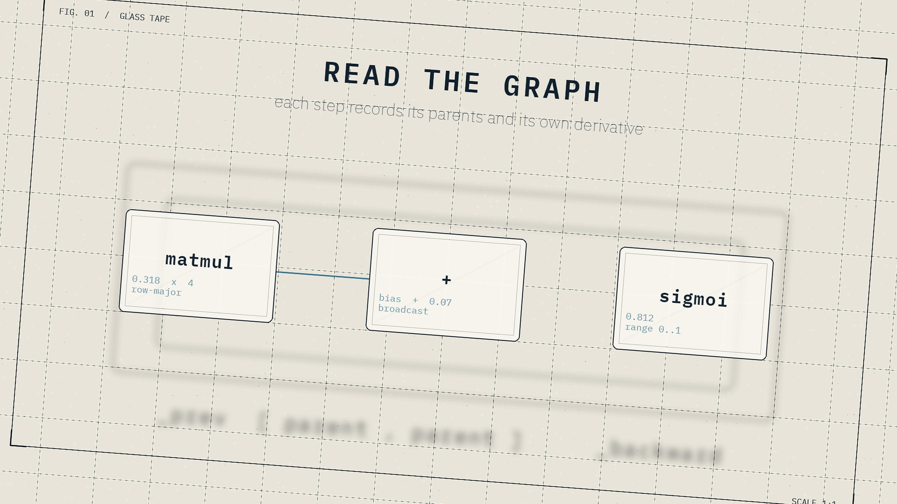
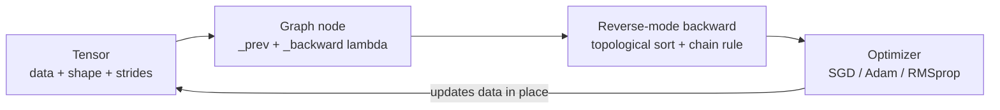
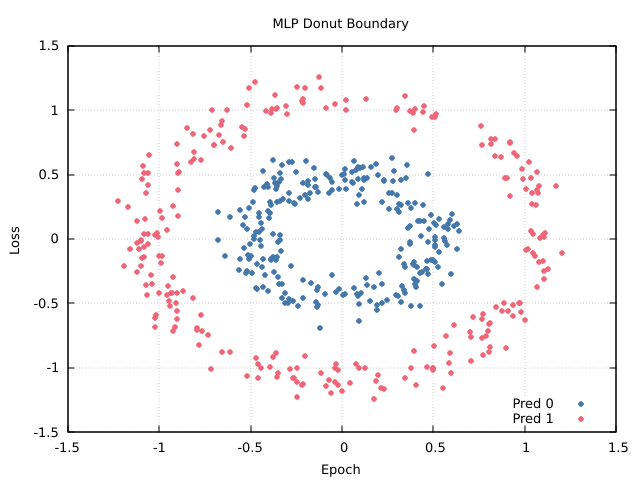
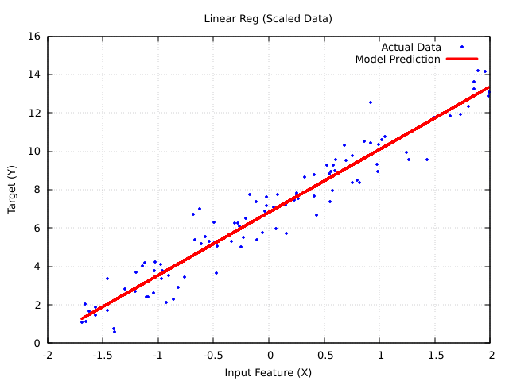

# MiniML-CPP

[](https://github.com/ibraramin/MiniML-CPP/actions/workflows/ci.yml) [](https://github.com/ibraramin/MiniML-CPP/releases) [](LICENSE)

A compact C++17 machine learning library written from scratch, for developers who want to read the autodiff engine end to end and verify its gradients instead of calling a framework's `backward()` and trusting it.

https://github.com/ibraramin/MiniML-CPP/releases/download/v0.2.0/brag.mp4
[](docs/assets/brag.mp4)

https://github.com/user-attachments/assets/22ee3e92-d8fd-4523-a611-d49bb6d0823a


The core uses only the C++ standard library. A C++17 compiler and CMake are enough to build, test, and run everything below. `gnuplot` is needed only by the optional legacy plotting header.

## Highlights

- **Tensor engine you can read.** Shape and stride bookkeeping, element-wise `+ - *`, `matmul`, `transpose`, `pow`, `sum`, `relu`, `sigmoid`, and `log` in `src/tensor.hpp` and `src/tensor.cpp`.
- **Reverse-mode autodiff on a dynamic tape.** Every operation records its parents in `_prev` and a local derivative in `_backward`. `backward()` walks the graph in reverse topological order and accumulates gradients into leaf buffers. The engine fits in one translation unit.
- **Composable modules and optimizers.** `Linear`, `Sigmoid`, `ReLU`, and `Sequential` expose `forward`, `parameters`, and `operator()`. Batch SGD, bias-corrected Adam with configurable `beta1`, `beta2`, and `eps`, and opt-in RMSprop all share the same `zero_grad()` / `step()` contract.
- **Data and evaluation helpers.** Seeded `train_test_split`, a deterministic mini-batch `DataLoader` with fixed Fisher-Yates shuffling and remainder batches, plus accuracy, confusion matrix, precision, recall, and F1 in `src/metrics.hpp`.
- **Training controls and persistence.** Opt-in `ConstantLR` and `StepLR` compute a rate from a step index without mutating tensors. Fixed-step central-difference gradient checking lives in `include/gradcheck.hpp`, and a versioned, endian-safe `MMLW` weight format with validation before write lives in `include/serialization.hpp`.
- **Estimators and a reproducible demo.** Linear, ridge, polynomial, logistic, linear SVM, and MLP estimators live in `src/models.hpp`. The XOR demo trains a 2-2-1 network with both SGD and Adam, prints `epoch,loss` CSV, and exits non-zero if a convergence or accuracy gate fails.

## Quickstart

```bash
git clone https://github.com/ibraramin/MiniML-CPP.git
cd MiniML-CPP
cmake -S . -B build -DCMAKE_BUILD_TYPE=Release
cmake --build build -j
ctest --test-dir build --output-on-failure
./build/examples/xor_demo
```

For the sanitizer pass:

```bash
cmake -S . -B build-asan -DCMAKE_BUILD_TYPE=Debug -DENABLE_ASAN=ON
cmake --build build-asan -j
ctest --test-dir build-asan --output-on-failure
```

`ENABLE_ASAN` is `OFF` by default. Turning it on adds `-fsanitize=address,undefined -fno-omit-frame-pointer` to compilation and linking. The original six-demo gnuplot showcase is documented in [src/readme.md](src/readme.md).

## Usage

A minimal training loop built from the same public headers. Seed parameters by hand because `Tensor::randn()` uses `random_device`:

```cpp
#include "tensor.hpp"
#include "nn.hpp"
#include "adam.hpp"

#include <memory>
#include <random>

static void seed(Tensor &t, std::mt19937 &gen)
{
    std::uniform_real_distribution<float> dist(-1.0f, 1.0f);
    for (std::size_t i = 0; i < t.total_size; ++i)
        t.data->at(i) = dist(gen);
}

int main()
{
    Tensor X({4, 2}), y({4, 1});
    const float xs[8] = {0, 0, 0, 1, 1, 0, 1, 1};
    const float ys[4] = {0, 1, 1, 0};
    for (int i = 0; i < 8; ++i) X.data->at(i) = xs[i];
    for (int i = 0; i < 4; ++i) y.data->at(i) = ys[i];

    auto l1 = std::make_shared<Linear>(2, 2);
    auto l2 = std::make_shared<Linear>(2, 1);
    Sequential model({l1, std::make_shared<Sigmoid>(),
                      l2, std::make_shared<Sigmoid>()});

    std::mt19937 gen(1);
    for (Tensor *p : model.parameters()) seed(*p, gen);

    Adam optim(model.parameters(), 0.05f);
    MSELoss mse;
    for (int step = 0; step < 1000; ++step)
    {
        optim.zero_grad();
        Tensor loss = mse(model(X), y);
        loss.backward();
        optim.step();
    }
}
```

Save it as `demo.cpp` at the repository root and run it against the built library:

```bash
g++ -std=c++17 -Isrc -Iinclude demo.cpp build/libminiml_core.a -o demo
./demo
```

See [docs/USAGE.md](docs/USAGE.md) for gradient checking, weight save and load, and the full XOR training program.

## Measured results

Recorded outputs from the commands above, not estimates. The gradient threshold was fixed in advance in [results/preregistration.md](results/preregistration.md).

| Check | Recorded result | Gate |
|---|---|---|
| Central-difference gradient check, `h = 1e-3` | worst relative error `1.889645e-04` | `2e-3` |
| Injected-defect control | `8e-3` defect gives `4.077007e-03` and exit 1; `2e-3` defect gives `1.091913e-03` and exit 0 | `2e-3` gate |
| Weight serialization round trip | max prediction difference `0.0`, byte-identical re-save, 4 corruption cases rejected | bad magic, version, truncation, huge dimensions |
| XOR classification | 4 / 4 rows correct for both optimizers | seed 1, 3000 epochs |
| CTest suite | 7 / 7 tests pass | Release and ASan/UBSan CI jobs |

The 2-2-1 model is `Sequential{Linear(2,2), Sigmoid, Linear(2,1), Sigmoid}`, trained on all four XOR rows with fixed initial weights. The program evaluates with a fresh forward pass and exits 0 only when both final losses clear `0.01` and both accuracies reach 4 / 4.

| Mode | Final loss | Threshold |
|------|-----------:|----------:|
| SGD  | 0.002114   | 0.01      |
| Adam | 0.000128   | 0.01      |

CI runs GCC, Clang, and ASan/UBSan jobs. The mini-batch loader, metrics, schedulers, and RMSprop are covered by correctness tests; no throughput benchmark was registered for them.

## Design



Each operation returns a new `Tensor` that records its parents and its local derivative. Calling `backward()` on a scalar loss walks the graph in reverse topological order and accumulates gradients into each leaf's `grad` buffer; an optimizer then updates the leaf `data` buffers. Schedulers sit outside this loop and only return a rate for a given step. See [docs/ARCHITECTURE.md](docs/ARCHITECTURE.md) for tensor layout, tape construction, modules, data loading, metrics, gradcheck, and serialization details.

## Project layout

- `src/tensor.hpp`, `src/tensor.cpp`: tensor storage, shapes, autodiff engine.
- `src/nn.hpp`: modules, SGD, MSELoss.
- `src/models.hpp`, `src/metrics.hpp`: estimators and binary-classification metrics.
- `src/data.hpp`: `Dataset`, `train_test_split`, deterministic mini-batch `DataLoader`.
- `src/plot.hpp`, `src/main.cpp`, `src/readme.md`: original gnuplot showcase.
- `include/gradcheck.hpp`, `include/adam.hpp`, `include/serialization.hpp`, `include/schedulers.hpp`, `include/rmsprop.hpp`: verification, optimizer, and opt-in headers.
- `tests/`, `examples/`: seven CTest cases covering gradcheck with a falsification control, serialization, mini-batching, binary metrics, schedulers, and RMSprop, plus the XOR demo.
- `CMakeLists.txt`, `.github/workflows/ci.yml`: build and CI.

## Scope boundaries

This codebase is deliberately small and CPU focused. Its boundaries are explicit:

- Autodiff is pointer-identity based. `backward()` deduplicates nodes by raw data pointer and `_prev` stores tensor copies. Build a fresh graph per step, keep parameter tensors alive while an optimizer holds their pointers, and do not reuse a node across backward calls.
- `backward()` clears only the root gradient. Call `zero_grad()` on parameters or through an optimizer before every pass, otherwise leaf gradients accumulate.
- There is no scalar constructor and no scalar `operator*`. Allocate a `Tensor` with a shape and write floats into `data->at(i)`.
- `MSELoss` returns a sum of squared errors, not a mean, so learning rates depend on batch size.
- Broadcasting is limited to one row-broadcast case in `operator+`. Other shape combinations throw.
- Execution is CPU only on a single device. There is no GPU backend, weight decay, gradient clipping, or checkpoint and resume metadata. Deterministic mini-batching, learning-rate schedules, and RMSprop are available as described above.
- `Tensor::randn()` uses `random_device` and is not reproducible. Deterministic tests and the XOR demo seed tensors by hand.
- Serialization stores raw float weights only: no optimizer state, topology, or names. Version 1 files encode integers and floats little-endian regardless of host byte order, and mismatched version, count, shape, truncation, or trailing bytes return `false`.
- `src/plot.hpp` drives `gnuplot` through `popen`. It is excluded from all tests and from the XOR demo.
- There are no thread-safety guarantees. Some helpers use `static thread_local` RNG state, while the tensor graph has no locking.
- CMake builds a static library and defines no install or export target.

## Original showcase gallery

Plots from the original six-demo gnuplot showcase in [src/readme.md](src/readme.md). These illustrate that showcase, not the verifiability test outputs.

| Estimator | Plot |
|---|---|
| MLP classifier |  |
| Linear regression |  |
| Logistic regression |  |
| Polynomial regression |  |
| Ridge regression |  |
| Linear SVM |  |

## Documentation

- [Architecture](docs/ARCHITECTURE.md): tensor layout, tape, optimizers, schedulers, modules, data loading, metrics, gradcheck, serialization.
- [Usage cookbook](docs/USAGE.md): build, seed, train, verify, save and load, run the XOR demo.
- [Contributing](CONTRIBUTING.md): Definition of Done commands, CI matrix, test and documentation expectations.
- [Pre-registered gradient gate](results/preregistration.md): threshold rationale and falsification design.

## License

MIT. See [LICENSE](LICENSE).

## Links

- [Repository](https://github.com/ibraramin/MiniML-CPP)
- [Releases](https://github.com/ibraramin/MiniML-CPP/releases)
- [CI workflow](https://github.com/ibraramin/MiniML-CPP/actions/workflows/ci.yml)
