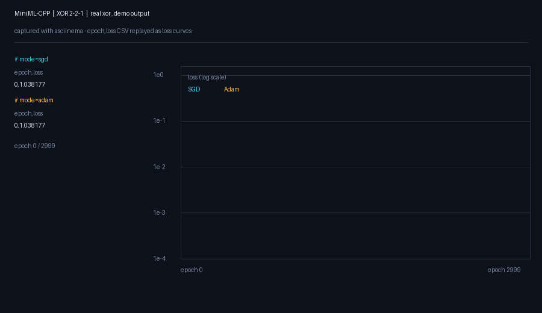
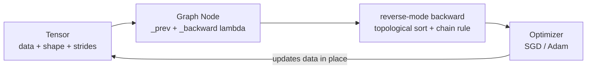
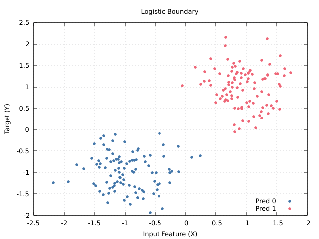
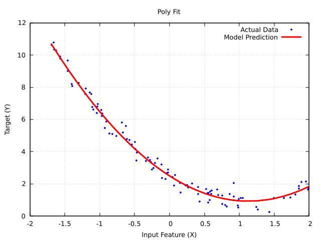
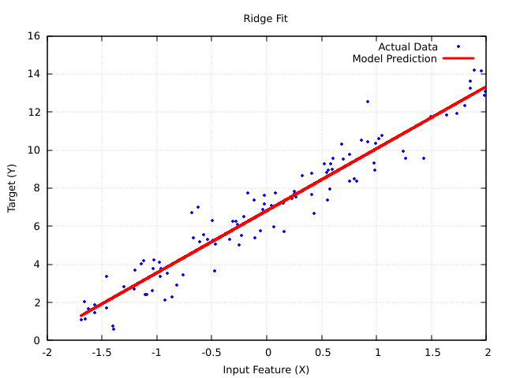
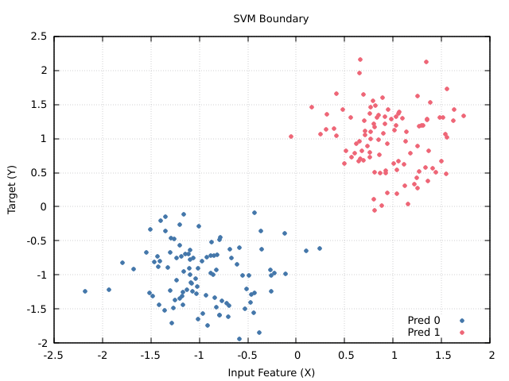

# MiniML-CPP

[](https://github.com/ibraramin/MiniML-CPP/actions/workflows/ci.yml) [](https://github.com/ibraramin/MiniML-CPP/releases) [](LICENSE)

> From-scratch C++17 machine learning you can read end to end — and verify, not just trust.

A small machine-learning library written from scratch in C++17. The core is the
C++ standard library only; `gnuplot` is used solely by the optional plotting
header and is **not** needed to build, test, or run the demos in this README.

**Why?** To make the internals visible. Instead of calling a framework's
`backward()`, you can read `src/tensor.cpp` and see a tape being built and
consumed. The library is deliberately tiny so the whole autodiff engine fits in
one file.

## Proof in two minutes

A real recording of the deterministic XOR training run featured below (1920×1080,
131 frames, roughly 18 seconds). It trains a 2-2-1 network with both SGD and Adam and prints
`epoch,loss` CSV as it goes.



Run the complete Definition of Done from the repository root. Every command is
copy-pasteable and must exit 0:

```bash
cmake -S . -B build -DCMAKE_BUILD_TYPE=Release
cmake --build build -j
ctest --test-dir build --output-on-failure
./build/examples/xor_demo
cmake -S . -B build-asan -DCMAKE_BUILD_TYPE=Debug -DENABLE_ASAN=ON
cmake --build build-asan -j
ctest --test-dir build-asan --output-on-failure
```

`ENABLE_ASAN=OFF` is the default. Turning it on adds
`-fsanitize=address,undefined -fno-omit-frame-pointer` to both compilation and
linking. For the original six-demo showcase (which **does** require `gnuplot`),
see `src/readme.md`.

## Architecture



Every operation returns a new `Tensor` that records its parents in `_prev` and
its local derivative in `_backward`. Calling `backward()` on a scalar loss
walks that graph in reverse topological order and accumulates gradients into
each leaf's `grad` buffer. An optimizer then updates the leaf `data` buffers.

## Features

- **Tensor engine** — shape/stride bookkeeping, element-wise `+ - *`, `matmul`,
  `transpose`, `pow`, `sum`, `relu`, `sigmoid`, `log`.
- **Reverse-mode autodiff** — a dynamically built tape with per-operation
  backward closures, implemented in `src/tensor.cpp`.
- **Neural modules** — `Linear`, `Sigmoid`, `ReLU`, `Sequential`, `Module`,
  following a familiar `forward`/`parameters`/`operator()` shape.
- **Estimators** — linear, ridge, polynomial, logistic, linear SVM and an MLP
  classifier in `src/models.hpp`; accuracy, confusion matrix, precision, recall
  and F1 helpers in `src/metrics.hpp`.
- **Optimizers** — batch SGD in `src/nn.hpp` and bias-corrected Adam in
  `include/adam.hpp`, plus an opt-in RMSprop in `include/rmsprop.hpp`.
- **Data preparation** — a deterministic mini-batch `DataLoader` with seeded
  shuffling and a `train_test_split` helper in `src/data.hpp`.
- **Learning-rate schedules** — opt-in `ConstantLR` and `StepLR` in
  `include/schedulers.hpp`; schedulers only compute a rate and do not mutate
  tensors.
- **Verifiability** — deterministic central-difference gradient checks
  (`include/gradcheck.hpp`, `tests/test_gradcheck.cpp`), a versioned
  endian-safe binary weight format (`include/serialization.hpp`,
  `tests/test_serialization.cpp`), and a reproducible XOR training demo
  (`examples/xor_demo.cpp`) that exercises both optimizers.
- **Optional plotting** — `src/plot.hpp` pipes commands to `gnuplot`.

## Usage

```cpp
#include "tensor.hpp"
#include "nn.hpp"
#include "adam.hpp"

int main() {
    Tensor X({4, 2}), y({4, 1});
    // fill X.data->at(i) / y.data->at(i) by hand for reproducibility;
    // Tensor::randn() is intentionally non-deterministic.

    auto layer = std::make_shared<Linear>(2, 1);
    Sequential model({layer, std::make_shared<Sigmoid>()});

    Adam optim(model.parameters(), 0.05f);
    MSELoss mse;
    for (int i = 0; i < 1000; ++i) {
        optim.zero_grad();
        Tensor loss = mse(model.forward(X), y);
        loss.backward();
        optim.step();
    }
}
```

## Results

Measured outputs from the commands above — no estimates.

| Check | Measured result | Gate |
|---|---|---|
| Gradient check (central difference) | worst relative error `1.889645e-04` | `2e-3` (pre-registered in `results/preregistration.md`) |
| Serialization round-trip | bit-exact (`0.0` difference) | 4 corruption cases rejected |
| XOR classification | 4 / 4 rows correct | seed 1, 3000 epochs |
| CTest suite | 7 tests | Release and ASan/UBSan |

The build needs only a C++17 compiler and CMake — zero new external
dependencies. CI runs GCC, Clang, and ASan/UBSan jobs. The mini-batch loader,
metrics, schedulers and RMSprop are verified for correctness only; no
performance benchmark was pre-registered for them.

### Deterministic XOR training

The 2-2-1 network `Sequential{Linear(2,2), Sigmoid, Linear(2,1), Sigmoid}` is
trained on all four XOR rows with fixed initial weights, once with SGD and once
with Adam. The program prints `epoch,loss` CSV for each mode and exits 0 only
when both final losses clear their measured thresholds.

| Mode | Initial loss | Final loss | Threshold |
|------|-------------:|-----------:|----------:|
| SGD  | 1.038177     | 0.002114   | 0.01      |
| Adam | 1.038177     | 0.000128   | 0.01      |

## Original showcase gallery

Plots from the original six-demo gnuplot showcase (`src/readme.md`). These are
illustrations from that showcase, not outputs of the verifiability tests.

| Estimator | Plot |
|---|---|
| MLP classifier |  |
| Linear regression |  |
| Logistic regression |  |
| Polynomial regression |  |
| Ridge regression |  |
| Linear SVM |  |

## Project structure

- `src/tensor.hpp`, `src/tensor.cpp` — tensor storage, shapes, autodiff engine.
- `src/nn.hpp` — modules, SGD, MSELoss.
- `src/models.hpp`, `src/metrics.hpp` — estimators and binary-classification
  metrics (accuracy, confusion matrix, precision, recall, F1).
- `src/data.hpp` — `Dataset`, `train_test_split` and the deterministic
  mini-batch `DataLoader`.
- `src/plot.hpp`, `src/main.cpp`, `src/readme.md` — the original gnuplot showcase.
- `include/gradcheck.hpp`, `include/adam.hpp`, `include/serialization.hpp`,
  `include/schedulers.hpp`, `include/rmsprop.hpp` — verification, optimizer and
  opt-in scheduler headers.
- `tests/`, `examples/` — seven CTest cases covering gradcheck (including a
  falsification control), serialization, the mini-batch loader, binary metrics,
  schedulers and RMSprop; plus the XOR demo.
- `CMakeLists.txt`, `.github/workflows/ci.yml` — build and CI.

## Documentation

- [Architecture](docs/ARCHITECTURE.md) — tensor layout, tape, optimizers, schedulers, modules, data loading, metrics, gradcheck, serialization.
- [Usage cookbook](docs/USAGE.md) — build, seed, train, verify, save/load, run the XOR demo.
- [Contributing](CONTRIBUTING.md) — DoD commands, CI matrix, test and documentation expectations.

## Limitations

This is an educational codebase, not a production framework. Be aware of:

- **Autodiff is pointer-identity based.** `backward()` deduplicates nodes by
  their raw data pointer, and `_prev` stores *copies* of tensors. Reusing a
  tensor node in several places in one graph, or holding graphs across many
  backward calls, can produce wrong gradients. Build a fresh graph per step.
- **`backward()` only clears the root gradient.** Call `zero_grad()` on your
  parameters (or use an optimizer's `zero_grad()`) before every backward pass;
  otherwise leaf gradients accumulate.
- **No scalar constructor and no scalar `operator*`.** Create a `Tensor` with a
  shape and write floats into `data->at(i)`. There is no `Tensor * float`.
- **Loss is a sum, not a mean.** `MSELoss` returns the sum of squared errors, so
  learning rates are batch-size dependent.
- **Limited broadcasting.** Only one specific row-broadcast case in `operator+`
  is supported; other shape combinations throw.
- **CPU-only, single device.** There is no GPU/CUDA backend or device model.
  Deterministic mini-batching and seeded shuffling are available through
  `DataLoader` (`src/data.hpp`), and opt-in schedulers (`include/schedulers.hpp`)
  and RMSprop (`include/rmsprop.hpp`) exist. Weight decay, gradient clipping,
  and checkpoint/resume metadata are still not supported.
- **`Tensor::randn()` uses `random_device`** and is therefore not reproducible;
  every deterministic test seeds its tensors by hand instead.
- **Serialization stores raw float weights only** — no optimizer state, no
  topology, no names. Version 1 files encode integers and floats little-endian
  regardless of host byte order; a mismatched version, count or shape fails
  cleanly.
- **`src/plot.hpp` calls `popen` to drive `gnuplot`.** It is excluded from all
  tests and from the XOR demo.
- **No thread-safety guarantees.** Several helpers use `static thread_local`
  RNG state but the tensor graph itself has no locking.
- **No install/export target** is provided by `CMakeLists.txt`.

## License

MIT — see [LICENSE](LICENSE).
