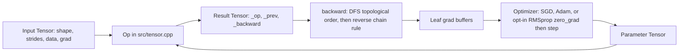

# Architecture

This document describes the code as it exists in this repository. The tensor
engine and tape live entirely in `src/tensor.cpp`; the remaining `src/*.hpp`
headers (except the excluded showcase files) are consumed directly by the test
binaries and the XOR demo (`CMakeLists.txt` builds only `src/tensor.cpp` into
`miniml_core`, and registers seven CTest cases). For build and
usage recipes, see [USAGE.md](USAGE.md); for the project-level rules, see the
root [README.md](../README.md).

## Data flow at a glance



## Tensor layout

`Tensor` is declared in `src/tensor.hpp` and implemented in `src/tensor.cpp`.
Its observable state:

| Member | Type | Meaning in the code |
|---|---|---|
| `data` | `std::shared_ptr<data_vec>` | `data_vec` is `std::vector<float>`; holds the values. |
| `grad` | `std::shared_ptr<data_vec>` | Same shape of storage; holds accumulated gradients. |
| `_prev` | `std::vector<std::shared_ptr<Tensor>>` | Copies of the parent tensors recorded by each operation. |
| `_op` | `std::string` | Operation label (`+`, `-`, `*`, `matmul`, `T`, `pow`, `sum`, `relu`, `sigmoid`, `log`); empty for leaves. |
| `_backward` | `std::function<void()>` | Closure that pushes local derivatives into parents' `grad`. |
| `shape`, `strides`, `total_size` | `size_vec`, `size_vec`, `size_t` | Dimensions, row-major strides, and product of dimensions. |

`Tensor(shape)` computes `total_size` as the product of the dimensions,
zero-fills both `data` and `grad`, and calls `calculate_stride()`. The stride
loop runs from the last dimension to the first, so `strides[i]` is the product
of all later dimensions (row-major layout). `print()` prints the shape and
`_op` to stdout.

`Tensor::randn(shape)` constructs a tensor, then fills it with
`normal_distribution<float>(0, 1)` samples scaled by
`sqrt(2.0f / (total_size + 1))`. Its generator is a `static thread_local`
`std::mt19937` seeded from `std::random_device`, so values are **not**
reproducible; deterministic tests seed `data->at(i)` by hand instead.

Copies of a `Tensor` (including the `std::make_shared<Tensor>(*this)` entries
stored in `_prev` and captured in `_backward`) copy the `shared_ptr`s. The
copies therefore alias the original `data` and `grad` buffers. This aliasing is
how a backward closure can update the original parameter's `grad`, and it is
also why graph objects should not be kept across steps.

## Tape construction

Every operation in `src/tensor.cpp` follows the same pattern: allocate a result
tensor, set `_op`, store parent **copies** in `_prev`, compute the forward
values into `result.data`, then assign a `_backward` lambda that captures
`self`, `other`, and `res` by value. Because those captures share the buffers,
`sg[i] += ...` inside the lambda writes to the original parent's gradient.

| Operation | `_op` | Local derivative applied in `_backward` |
|---|---|---|
| `operator+` | `+` | Add `res.grad[i]` to both parents; special row-broadcast path adds `g` to `og[j]`. |
| `operator-` | `-` | Add `res.grad[i]` to left parent, subtract from right parent. |
| `operator*` | `*` | Add `d2[i] * rg[i]` to left, `d1[i] * rg[i]` to right (element-wise). |
| `matmul` | `matmul` | Two nested sums over `rg`, accumulating into left and right parent grads. |
| `transpose` | `T` | Add `rg[j * M + i]` to `sg[i * N + j]`. |
| `pow(exp)` | `pow` | Add `exp * pow(sd[i], exp - 1) * rg[i]`. |
| `sum()` | `sum` | Returns shape `{1}`; adds `res.grad->at(0)` to every source element. |
| `relu()` | `relu` | Passes `rg[i]` only where `sd[i] > 0`. |
| `sigmoid()` | `sigmoid` | Passes `y * (1 - y) * rg[i]`, with `y` from the result's data. |
| `log()` | `log` | Passes `rg[i] / (sd[i] + eps)`, with `eps = 1e-7f` in both forward and backward. |

Shape rules are strict: `-` and element-wise `*` throw `std::invalid_argument`
on any shape mismatch. `+` permits exactly one broadcast case — both operands
rank 2, different row counts, right operand with one row, and equal column
counts; other combinations throw `"Shape mismatch in +"`. `matmul` indexes
`A[i * K + k]` and `B[k * N + j]` for `M = shape[0]`, `K = shape[1]`,
`N = t2.shape[1]`. No scalar constructor and no `Tensor * float` overload
exist.

## `backward()` and traversal

`Tensor::backward()` builds its topological order on demand:

1. A DFS lambda `build_topo` starts at the root, skips nodes already in a
   `std::set<float *>` keyed by `get_raw(v.data)`, inserts each node before
   recursing into `_prev`, and appends the node to `topo` **after** its
   children.
2. The root's `grad` buffer is filled with `0.0f`, `grad[0]` is set to `1.0f`,
   and if `total_size > 1` the whole root `grad` is filled with `1.0f`.
3. `topo` is walked in reverse (`rbegin()` to `rend()`), invoking each
   `_backward` closure if one is present.

Two consequences matter in practice. Dedup is by raw data pointer, not by node
identity, so reusing a node in several places in one graph, or retaining a
graph across multiple backward passes, can give wrong gradients — build a
fresh graph per step. And `backward()` only resets the **root** gradient, not
the leaves', so call `zero_grad()` on parameters (or on the optimizer) before
each pass; `Tensor::zero_grad()` simply fills its own `grad` with zeros.

`MSELoss::operator()` is `(pred - target).pow(2.0f).sum()`: a **sum**, not a
mean, so learning rates are batch-size dependent.

## Optimizers and parameter iteration

The two core optimizers take `std::vector<Tensor *>` from `Module::parameters()`, expose `zero_grad()` and `step()`, and require the parameter tensors to outlive them.

- `SGD` (`src/nn.hpp`): `(params, lr)`; `zero_grad()` zeros each parameter's `grad`;
  `step()` does `d[i] -= lr * g[i]` over `p->total_size`.
- `Adam` (`include/adam.hpp`): `Adam(params, lr = 0.001f, beta1 = 0.9f, beta2 = 0.999f,
  eps = 1e-8f)`; one `m` and one `v` vector per parameter, initialized to zero.
  Each `step()` increments `t`, computes
  `bc1 = 1 - beta1^t` and `bc2 = 1 - beta2^t`, updates
  `m = beta1*m + (1-beta1)*g` and `v = beta2*v + (1-beta2)*g*g`, then applies
  `d -= lr * (m/bc1) / (sqrt(v/bc2) + eps)`. The division by `bc1`/`bc2` is the
  bias correction. `zero_grad()` has the same behavior as SGD's. Adam state
  (`t`, `m`, `v`) is not serialized.

`RMSprop` (`include/rmsprop.hpp`) is an **opt-in** optimizer: nothing in `src/`
includes that header, so including it explicitly is the feature gate and the
existing `src/nn.hpp` semantics are unchanged. It follows the same
`RMSprop(params, lr = 0.01f, decay = 0.9f, eps = 1e-8f)` / `zero_grad()` /
`step()` convention. Its constructor rejects `decay` outside `[0, 1]` and
negative `eps`. Per parameter it keeps a vector of squared-gradient
accumulators; each step computes `v = decay * v + (1 - decay) * g * g` and then
`d -= lr * g / (sqrt(v) + eps)`. `zero_grad()` only clears parameter
gradients, **not** the accumulators. `squared_average(k)` exposes a read-only
view of one accumulator for tests.

## Learning-rate schedulers

`include/schedulers.hpp` is likewise opt-in: schedulers only map a step index
to a learning rate and never mutate tensors.

- `ConstantLR(lr)` returns `lr` from `get_lr(step)` at every step; `base_lr()`
  reports it.
- `StepLR(lr, gamma, step_size)` returns
  `lr * gamma^(floor(step / step_size))` from `get_lr(step)`. Its constructor
  throws `std::invalid_argument` when `step_size == 0`; `base_lr()`, `gamma()`
  and `step_size()` are accessors.

## Modules

`Module` (`src/nn.hpp`) is abstract: implement `forward(Tensor)` and
`parameters() -> std::vector<Tensor *>`; `operator()(x)` calls `forward(x)`, and
`zero_grad()` zeros all parameters returned by `parameters()`.

- `Linear(in, out)` owns `weight` of shape `{out, in}` and `bias` of shape
  `{1, out}`, both from `Tensor::randn`. `forward(x)` is
  `x.matmul(weight.transpose()) + bias` — the bias relies on the one supported
  row-broadcast case. `parameters()` returns `{&weight, &bias}`.
- `Sigmoid` and `ReLU` call `x.sigmoid()` / `x.relu()` and return an empty
  parameter list.
- `Sequential` stores `std::shared_ptr<Module>` layers given as an
  initializer list; `forward()` chains them, and `parameters()` concatenates
  each layer's list in order.

`src/models.hpp` builds estimators (`LinearRegression`, `RidgeRegression`,
`PolynomialRegression`, `LogisticRegression`, `LinearSVM`, `MLPClassifier`) on
the same modules and SGD loop. `src/metrics.hpp` provides
`Metrics::accuracy(y_true, y_pred, thresh = 0.5f)`: predictions are thresholded
at `thresh` and compared with `std::abs(p - y_true) < 1e-5`. It also adds binary
classification helpers: `confusion(y_true, y_pred, thresh = 0.5f)` returns a
`ConfusionMatrix` (`tp`, `fp`, `tn`, `fn`, plus `total()`), where the label is
true when `y_true >= 0.5f` and the prediction is true when
`y_pred >= thresh`. `confusion()` throws `std::invalid_argument` when the two
tensors differ in size or are empty. `precision()` (`tp/(tp+fp)`), `recall()`
(`tp/(tp+fn)`) and `f1()` (the harmonic mean of the two) all recompute the
counts via `confusion()` and return `0.0f` for an undefined zero-denominator
ratio instead of `NaN`.

## Data loading

`src/data.hpp` defines `Dataset` (a pair of `Tensor`s, `X` and `y`) and two
helpers, neither of which touches autodiff — they only reorder and copy rows of
tensor `data`:

- `DataUtils::train_test_split(X, y, test_size = 0.2f, seed = 42)` shuffles a
  `std::vector` of row indices with `std::mt19937(seed)` and returns
  `{train, test}` `Dataset`s. The test count is `n_samples * test_size`.
- `DataLoader(X, y, batch_size, seed = 42)` is a deterministic mini-batch
  loader. It throws `std::invalid_argument` for `batch_size == 0`, `X` of rank
  below 2, or a `y` sample count different from `X`'s. `batches_per_epoch()` is
  `ceil(n / batch_size)` and the last batch may be smaller; `batch(index)`
  copies those rows into fresh tensors and throws `std::out_of_range` for an
  out-of-range index. `begin()`/`end()` iterate one epoch's batches, and
  `epoch_batches()` materialises them all. `reshuffle(epoch_index)` rebuilds the
  row order with our own Fisher-Yates loop driven by `mt19937(seed +
  epoch_index)`, so the same seed and epoch index give the same permutation on
  every run regardless of `std::shuffle`'s implementation; `next_epoch()`
  increments `epoch_` and reshuffles with that index.

## Gradcheck

`include/gradcheck.hpp` (namespace `miniml_gradcheck`) does deterministic
central differences. `kH = 1e-3f`. `numerical_gradient(param, index, h, loss_fn)`
saves the original float, perturbs it by `+h` then `-h`, evaluates `loss_fn()`
each time, reads `data->at(0)`, and returns `(f(x+h) - f(x-h)) / (2h)` computed
in `double`. A `RestoreValue` destructor restores the value on every exit path.

`analytical_gradient(param, index, loss_fn)` calls `param.zero_grad()`, builds
a loss, calls `backward()`, and reads `param.grad->at(index)`. `loss_fn` must
return a fresh scalar tensor each call (shape `{1}`) because the graph is
pointer-identity based. `relative_error(a, b)` is `|a-b| / max(1e-8, |a|+|b|)`.

`tests/test_gradcheck.cpp` covers element-wise add, element-wise multiply,
sigmoid, and a `Linear` layer's weight and bias through `MSELoss`, seeding all
tensors by hand. Its threshold was tightened from `1e-2f` to `2.0e-3f`, a value
pre-registered in `results/preregistration.md` against the recorded worst
relative error `1.889645e-04` (~10.6x margin). `CMakeLists.txt` also registers
`gradcheck_falsification` (`WILL_FAIL TRUE`), which invokes `test_gradcheck`
with `--falsify` and a deliberately injected multiplicative gradient defect;
that run must exit 1 and print `FAIL gradcheck`. The unmodified binary reports
the same worst relative error in Release and ASan/UBSan builds.

## Serialization format

`include/serialization.hpp` (namespace `miniml_serialization`) writes raw
float weights only — no topology, names, or optimizer state. `kMagic` is
`"MMLW"` and `kVersion` is `1`.

```text
char[4]   magic "MMLW"
uint16    version = 1
uint32    count                     // number of tensors
per tensor:
  uint32  rank
  uint32  dim[rank]
  float32 data[product(dim)]        // IEEE-754 binary32
```

Every field is emitted byte by byte, little-endian (`put_u16`, `put_u32`,
`put_f32` with a `static_assert` that `float` is 4 bytes); no struct is dumped,
so host endianness and alignment do not affect the file. `save(path, weights)`
returns `false` for an empty path, null pointers, or dimensions/ranks that do
not fit `uint32_t`; otherwise it writes the buffer and returns stream status.
`load(path, weights)` returns `false` rather than throwing on bad magic,
unsupported version, count mismatch, rank `0` or `> 8`, zero dimensions,
product overflow, truncation, trailing bytes, or destination shape mismatch.
It parses and validates the entire file before copying any values into
destination tensors.

`tests/test_serialization.cpp` checks a bit-exact round-trip (recorded max
prediction difference `0`), byte-stable re-save, and clean rejection of
truncation, bad magic, bad version, count/shape mismatch (without mutating the
destination), trailing garbage, and crafted huge dimensions.

## Pitfalls documented in the README

- **Pointer-identity dedup** — `backward()` keys `visited` on raw data pointers and `_prev` holds tensor copies; build a fresh graph per step.
- **`zero_grad()` before backward** — only the root grad is reset by `backward()`; leaf grads accumulate otherwise.
- **No scalar constructor / no scalar `operator*`** — create a shaped tensor and write `data->at(i)`.
- **Sum, not mean loss** — `MSELoss` sums squared errors; learning rates depend on batch size.
- **Limited broadcasting** — only the one row-broadcast case in `operator+`; other shapes throw.
- **CPU-only, single device** — no GPU/CUDA backend or device model; weight decay, gradient clipping and checkpoint/resume metadata are still absent. Deterministic mini-batching/seeded shuffling (`src/data.hpp`) and opt-in schedulers/RMSprop (`include/`) do exist.
- **Other limits** — non-reproducible `randn`, raw-float-only serialization, `popen` plotting, no thread-safety guarantees, no install/export target.

## File-by-file map

| Path | Role |
|---|---|
| `CMakeLists.txt` | C++17 static library `miniml_core` from `src/tensor.cpp`; seven CTest cases and the XOR demo. `ENABLE_ASAN` adds ASan/UBSan flags; `ENABLE_O3_EXTRAS` (ON by default) gates the scheduler/RMSprop test targets. |
| `README.md` | Overview, DoD commands, measured results, gallery, limitations. |
| `src/readme.md` | Original six-demo gnuplot showcase notes. |
| `src/tensor.hpp` / `src/tensor.cpp` | Tensor declaration; stride math, ops, tape, backward. Only `.cpp` is compiled. |
| `src/nn.hpp` | `Module`, `Linear`, `Sigmoid`, `ReLU`, `Sequential`, `SGD`, `MSELoss`. |
| `src/models.hpp` / `src/metrics.hpp` | Estimators; accuracy, confusion matrix, precision, recall and F1 helpers. |
| `src/data.hpp` | `Dataset`, `train_test_split`, deterministic mini-batch `DataLoader`. |
| `src/plot.hpp` / `src/main.cpp` | Optional gnuplot showcase; excluded from tests and the XOR demo. |
| `include/adam.hpp` | Bias-corrected Adam optimizer. |
| `include/gradcheck.hpp` / `include/serialization.hpp` | Gradient checks; version 1 `MMLW` weight format. |
| `include/schedulers.hpp` / `include/rmsprop.hpp` | Opt-in `ConstantLR`/`StepLR` rate schedules and RMSprop optimizer. |
| `tests/test_*.cpp` | Deterministic CTest binaries: gradcheck (plus falsification control), serialization, mini-batch loader, binary metrics, schedulers, RMSprop. |
| `examples/xor_demo.cpp` | Deterministic 2-2-1 XOR training with both optimizers. |
| `.github/workflows/ci.yml` | GCC/Clang and ASan/UBSan jobs. |
| `docs/USAGE.md`, `CONTRIBUTING.md` | Cookbook and contribution rules. |
